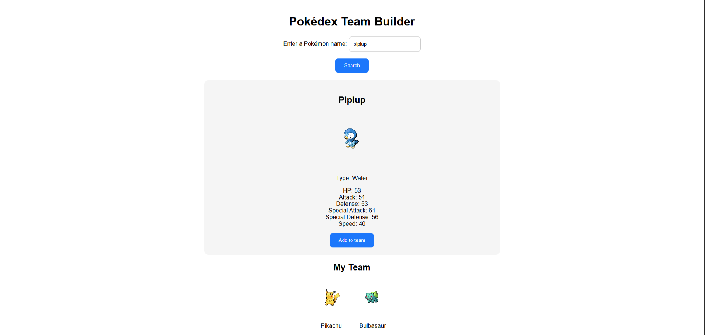

# Pokédex Team Builder

A Pokédex search and team builder using the PokéAPI, built with HTML, CSS, and JavaScript.

**Live site:** https://sburbo42.github.io/pokedex-team-builder/

## Features

- Search for any Pokémon by name
- View its image, type, and base stats
- Build a team of up to six Pokémon
- Your team is saved in the browser, so it's still there after a refresh
- Friendly message when a Pokémon isn't found

## Built With

- HTML
- CSS (Flexbox)
- JavaScript (Fetch API, async/await, localStorage)
- [PokéAPI](https://pokeapi.co/)

## How It Works

When you search, the app sends a request to PokéAPI and waits for the response. It then pulls the name, image, types, and stats from the data and displays them on the page. Team members are stored in an array and saved to localStorage as text, then loaded back in when the page opens.

## What I Learned

- How to request data from an API with fetch, and why asynch and await are needed when waiting on a response from the internet.
- Handling errors by checking response.ok and using return to stop a function early.
- Saving and loading data with localStorage, and converting it with JSON.stringify and JSON.parse.
- Working with Git branches for each new feature, then merging them into main.
- Deploying a site with GitHub Pages

## Future Improvements

- Remove Pokémon from the team
- Mobile-friendly layout